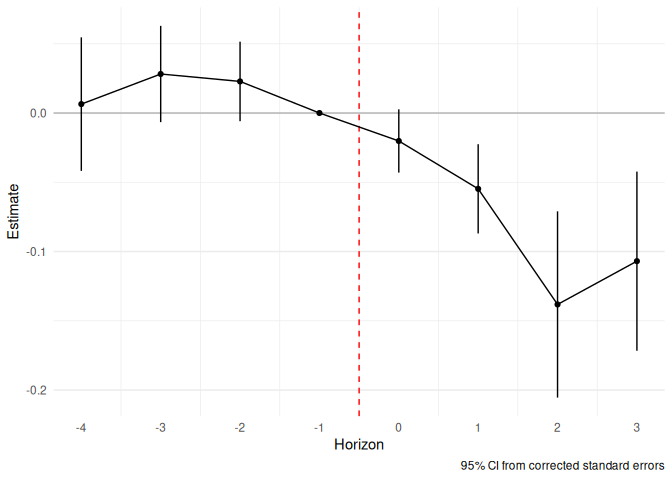
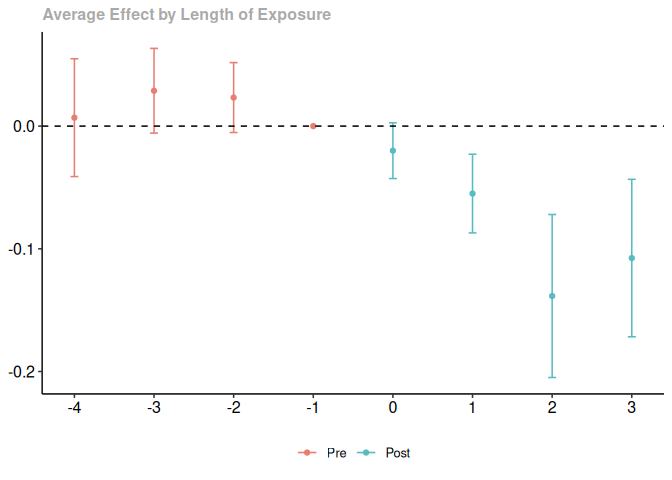
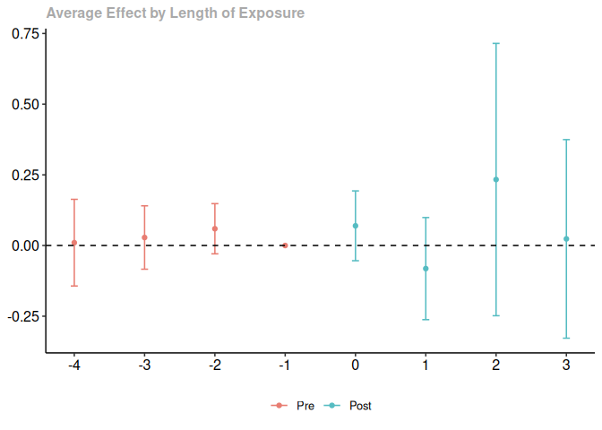
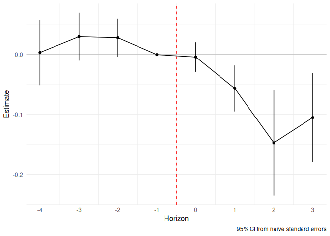

Comparing `lpdidcsa` and `did` Packages for Difference-in-Differences
Estimation
================
Olivier Godechot
2026-10-25

# Introduction

This vignette shows how to use the `lpdidcsa` package for
difference-in-differences (DiD) estimation and compares its results with
those from the `did` package by Callaway and Sant’Anna. We focus on two
estimation methods: inverse probability weighting (IPW) and regression
adjustment. Additionally, we explore how `lpdidcsa` handles missing
values, showcasing its pair rebalancing approach.

# Setup

First, load the required packages and set the working directory.

``` r
library(data.table)
library(did)
library(lpdidcsa)
setwd(dirname(rstudioapi::getActiveDocumentContext()$path))
```

    ## Error in setwd(dirname(rstudioapi::getActiveDocumentContext()$path)): impossible de changer de répertoire de travail

# Data Preparation

We use the `mpdta_r` dataset from the `lpdidcsa` package for our
analysis.

``` r
data(mpdta_r, package = "lpdidcsa")

mpdta_w  <- lpdidcsa_data(mpdta_r, unit = "countyreal", time = "year",
                     dependent = "lemp", treat = "treat")
```

# Comparison of Estimation Methods

## Inverse Probability Weighting (IPW)

### Using `did` Package

``` r
csa_ipw_det <- att_gt(
  yname = "lemp",
  tname = "year",
  idname = "countyreal",
  gname = "first.treat",
  base_period = "universal",
  control_group = c("notyettreated"),
  est_method = "ipw",
  bstrap = FALSE,
  cband = FALSE,
  xformla = ~lpop,
  data = mpdta_r
)
# summary(csa_ipw_det)
csa_ipw <- aggte(csa_ipw_det, type = "dynamic")
# summary(csa_ipw)
ggdid(csa_ipw)
```

<!-- -->

### Using `lpdidcsa` Package

To obtain equivalent results to those of the `did` package, we use the
option time_x_controls which interacts covariates with time dummy
variables.

``` r
lpdidcsa_ipw <- lpdidcsa(
  data = mpdta_w,
  meth = "lpdid_ipw",
  dtreat = "dtreat",
  time = "year",
  unit = "countyreal",
  dependent = "lemp",
  controls = "lpop",
  time_x_controls = T,
  se_correction_rw_ipw= T
)
```

    ## [1] "Horizon -4"
    ## [1] "- Propensity score regression"
    ## [1] "- LPDiD regression"
    ## [1] "- Standard error correction"
    ## [1] "Horizon -3"
    ## [1] "- Propensity score regression"
    ## [1] "- LPDiD regression"
    ## [1] "- Standard error correction"
    ## [1] "Horizon -2"
    ## [1] "- Propensity score regression"
    ## [1] "- LPDiD regression"

    ## [1] "- Standard error correction"
    ## [1] "Horizon 0"
    ## [1] "- Propensity score regression"
    ## [1] "- LPDiD regression"

    ## [1] "- Standard error correction"
    ## [1] "Horizon 1"
    ## [1] "- Propensity score regression"
    ## [1] "- LPDiD regression"

    ## [1] "- Standard error correction"
    ## [1] "Horizon 2"
    ## [1] "- Propensity score regression"
    ## [1] "- LPDiD regression"

    ## [1] "- Standard error correction"
    ## [1] "Horizon 3"
    ## [1] "- Propensity score regression"
    ## [1] "- LPDiD regression"
    ## [1] "- Standard error correction"

``` r
lpdidcsa_ipw$plot
```

<!-- -->

### Comparison of Results

``` r
cbind(
  csa_ipw$att.egt[csa_ipw$att.egt != 0],
  csa_ipw$se.egt[csa_ipw$att.egt != 0]
) - lpdidcsa_ipw$est[lpdidcsa_ipw$est$estimate != 0, c("estimate", "se_correct")]
```

    ##         estimate    se_correct
    ##            <num>         <num>
    ## 1: -8.847090e-17 -5.596886e-05
    ## 2:  5.426215e-15 -3.774740e-05
    ## 3: -2.225588e-10 -3.119224e-05
    ## 4: -7.592538e-14 -2.397630e-05
    ## 5:  1.151856e-15 -3.582223e-05
    ## 6:  9.436896e-16 -7.464952e-05
    ## 7: -1.387779e-16 -1.004461e-04

## Regression adjustment

### Using `did` Package

``` r
csa_adj_det <- att_gt(
  yname = "lemp",
  tname = "year",
  idname = "countyreal",
  gname = "first.treat",
  base_period = "universal",
  control_group = c("notyettreated"),
  est_method = "reg",
  bstrap = FALSE,
  cband = FALSE,
  xformla = ~lpop,
  data = mpdta
)
# summary(csa_adj_det)
csa_adj <- aggte(csa_adj_det, type = "dynamic")
# summary(csa_adj)
ggdid(csa_adj)
```

<!-- -->

### Using `lpdidcsa` Package

Here again, to obtain equivalent results to those of the `did` package,
we use the option time_x_controls which interacts covariates with time
dummy variables.

``` r
lpdidcsa_adj <- lpdidcsa(
  data = mpdta_w,
  meth = "lpdid_adj",
  dtreat = "dtreat",
  time = "year",
  unit = "countyreal",
  dependent = "lemp",
  controls = "lpop",
  time_x_controls = T,
  type_horizon = "wide"
)
```

    ## [1] "Horizon -4"
    ## [1] "- Outcome regression on the control group"
    ## [1] "- LPDiD regression"
    ## [1] "- Standard error correction"
    ## [1] "Horizon -3"
    ## [1] "- Outcome regression on the control group"
    ## [1] "- LPDiD regression"
    ## [1] "- Standard error correction"
    ## [1] "Horizon -2"
    ## [1] "- Outcome regression on the control group"
    ## [1] "- LPDiD regression"
    ## [1] "- Standard error correction"
    ## [1] "Horizon 0"
    ## [1] "- Outcome regression on the control group"
    ## [1] "- LPDiD regression"
    ## [1] "- Standard error correction"
    ## [1] "Horizon 1"
    ## [1] "- Outcome regression on the control group"
    ## [1] "- LPDiD regression"
    ## [1] "- Standard error correction"
    ## [1] "Horizon 2"
    ## [1] "- Outcome regression on the control group"
    ## [1] "- LPDiD regression"
    ## [1] "- Standard error correction"
    ## [1] "Horizon 3"
    ## [1] "- Outcome regression on the control group"
    ## [1] "- LPDiD regression"
    ## [1] "- Standard error correction"

``` r
lpdidcsa_adj$plot
```

<!-- -->

### Comparison of Results

``` r
cbind(
  csa_adj$att.egt[csa_adj$att.egt != 0],
  csa_adj$se.egt[csa_adj$att.egt != 0]
) - lpdidcsa_adj$est[lpdidcsa_adj$est$estimate != 0, c("estimate", "se_correct")]
```

    ##         estimate    se_correct
    ##            <num>         <num>
    ## 1: -2.515349e-17  6.938894e-18
    ## 2:  2.775558e-17  3.816392e-17
    ## 3: -1.110223e-16  3.469447e-18
    ## 4:  1.249001e-16  1.561251e-17
    ## 5: -1.040834e-16  6.938894e-18
    ## 6: -2.775558e-17 -6.938894e-17
    ## 7:  0.000000e+00 -6.938894e-18

## Double Robust

### Using `did` Package

``` r
csa_adj_det <- att_gt(
  yname = "lemp",
  tname = "year",
  idname = "countyreal",
  gname = "first.treat",
  base_period = "universal",
  control_group = c("notyettreated"),
  est_method = "dr",
  bstrap = FALSE,
  cband = FALSE,
  xformla = ~lpop,
  data = mpdta
)
# summary(csa_adj_det)
csa_dr <- aggte(csa_adj_det, type = "dynamic")
# summary(csa_adj)
ggdid(csa_dr)
```

<!-- -->

### Using `lpdidcsa` Package

Here again, to obtain equivalent results to those of the `did` package,
we use the option time_x_controls which interacts covariates with time
dummy variables.

``` r
lpdidcsa_dr <- lpdidcsa(
  data = mpdta_w,
  meth = "lpdid_dr",
  dtreat = "dtreat",
  time = "year",
  unit = "countyreal",
  dependent = "lemp",
  controls = "lpop",
  time_x_controls = T,
  type_horizon = "wide"
)
```

    ## [1] "Horizon -4"
    ## [1] "- Propensity score regression"
    ## [1] "- Outcome regression on the control group"
    ## [1] "- Standard error correction"
    ## [1] "Horizon -3"
    ## [1] "- Propensity score regression"
    ## [1] "- Outcome regression on the control group"
    ## [1] "- Standard error correction"
    ## [1] "Horizon -2"
    ## [1] "- Propensity score regression"
    ## [1] "- Outcome regression on the control group"
    ## [1] "- Standard error correction"
    ## [1] "Horizon 0"
    ## [1] "- Propensity score regression"
    ## [1] "- Outcome regression on the control group"
    ## [1] "- Standard error correction"
    ## [1] "Horizon 1"
    ## [1] "- Propensity score regression"
    ## [1] "- Outcome regression on the control group"
    ## [1] "- Standard error correction"
    ## [1] "Horizon 2"
    ## [1] "- Propensity score regression"
    ## [1] "- Outcome regression on the control group"
    ## [1] "- Standard error correction"
    ## [1] "Horizon 3"
    ## [1] "- Propensity score regression"
    ## [1] "- Outcome regression on the control group"
    ## [1] "- Standard error correction"

``` r
lpdidcsa_dr$plot
```

<!-- -->

### Comparison of Results

``` r
cbind(
  csa_dr$att.egt[csa_adj$att.egt != 0],
  csa_dr$se.egt[csa_adj$att.egt != 0]
) - lpdidcsa_dr$est[lpdidcsa_adj$est$estimate != 0, c("estimate", "se_correct")]
```

    ##        estimate    se_correct
    ##           <num>         <num>
    ## 1: 3.903128e-17 -3.153507e-05
    ## 2: 3.743650e-07 -2.018584e-05
    ## 3: 2.930180e-07 -1.677075e-05
    ## 4: 1.420446e-07 -9.751267e-06
    ## 5: 4.692821e-09 -1.663598e-05
    ## 6: 5.010964e-12 -3.726197e-05
    ## 7: 1.387779e-17 -5.002027e-05

# Handling Missing Values

## Creating a Dataset with Missing Values on the dependent variable

``` r
set.seed(444)
mpdta_r[, noise := runif(nrow(mpdta_r))]
mpdta_r[, drop := 1 - (noise > 0.1)]
mpdta_r[, lemp_mis := fifelse(drop==1,NA,lemp)]
mpdta_r[, rebal := (sum(!is.na(lemp_mis)) == 5) * 1, by = countyreal]
# mpdta_na[,.N, by = rebal]
```

## Estimating with Unbalanced Data

### Using `did` Package

``` r
csa_unbal_det <- att_gt(
  yname = "lemp_mis",
  tname = "year",
  idname = "countyreal",
  gname = "first.treat",
  base_period = "universal",
  allow_unbalanced_panel = TRUE,
  control_group = c("notyettreated"),
  bstrap = FALSE,
  cband = FALSE,
  data = mpdta_r
)
# summary(csa_unbal_det)
csa_unbal <- aggte(csa_unbal_det, type = "dynamic")
# summary(csa_unbal)
ggdid(csa_unbal)
```

<!-- -->

### Using `lpdidcsa` Package with Partial Rebalancing

``` r
mpdta_r_mis_w <- lpdidcsa_data(
  data = mpdta_r,
  treat = "treat",
  dependent = "lemp_mis",
  unit = "countyreal",
  type_horizon = "wide"
)
didpartbal <- lpdidcsa(
  data = mpdta_r_mis_w,
  meth = "lpdid_rw",
  dtreat = "dtreat",
  time = "year",
  unit = "countyreal",
  dependent = "lemp_mis",
  type_horizon = "wide"
)
```

    ## [1] "Horizon -4"
    ## [1] "- LPDiD Regression"
    ## [1] "Horizon -3"
    ## [1] "- LPDiD Regression"
    ## [1] "Horizon -2"
    ## [1] "- LPDiD Regression"

    ## [1] "Horizon 0"
    ## [1] "- LPDiD Regression"

    ## [1] "Horizon 1"
    ## [1] "- LPDiD Regression"

    ## [1] "Horizon 2"
    ## [1] "- LPDiD Regression"

    ## [1] "Horizon 3"
    ## [1] "- LPDiD Regression"

``` r
didpartbal$plot
```

<!-- -->

## Comparison of Results with Missing Values

``` r
# Difference between CSA's unbalanced estimate and lpdidcsa partially rebalanced estimate
cbind(
  csa_unbal$att.egt[csa_unbal$att.egt != 0],
  csa_unbal$se.egt[csa_unbal$att.egt != 0]
) - didpartbal$est[didpartbal$est$estimate != 0, c("estimate", "se")]
```

    ##        estimate         se
    ##           <num>      <num>
    ## 1:  0.006437879 0.05038391
    ## 2: -0.001648563 0.03681060
    ## 3:  0.031227138 0.02893664
    ## 4:  0.073703124 0.05049853
    ## 5: -0.025199574 0.07253909
    ## 6:  0.380350736 0.20087674
    ## 7:  0.128465496 0.14132044

``` r
# Difference between CSA's rebalanced estimate and lpdidcsa partially rebalanced estimate
csa_rebal_det <- att_gt(
  yname = "lemp_mis",
  tname = "year",
  idname = "countyreal",
  gname = "first.treat",
  base_period = "universal",
  allow_unbalanced_panel = FALSE,
  control_group = c("notyettreated"),
  bstrap = FALSE,
  cband = FALSE,
  data = mpdta_r
)
csa_rebal <- aggte(csa_rebal_det, type = "dynamic")
cbind(
  csa_rebal$att.egt[csa_rebal$att.egt != 0],
  csa_rebal$se.egt[csa_rebal$att.egt != 0]
) - didpartbal$est[didpartbal$est$estimate != 0, c("estimate", "se")]
```

    ##         estimate          se
    ##            <num>       <num>
    ## 1: -1.638645e-03 0.005971997
    ## 2:  7.458002e-05 0.003939911
    ## 3: -3.797766e-03 0.003338214
    ## 4: -6.215463e-03 0.002915472
    ## 5:  2.151399e-02 0.003946895
    ## 6:  1.569433e-02 0.011271072
    ## 7:  5.180721e-03 0.007262514

# Conclusion

This vignette demonstrates the use of the `lpdidcsa` package for DiD
estimation and compares its results with the `did` package in R. The
`lpdidcsa` package offers a robust approach to handling missing values
through pair rebalancing, which can yield estimates closer to the “true”
values without significant loss of power. (Pair balancing is also
available in Callaway and Sant’Anna’s Stata package csdid. This option
is not yet available in R. Here, it gives the same result as LPDiD).

For further details, refer to the package documentation and the original
papers by Callaway and Sant’Anna, and the methodology behind `lpdidcsa`.

\`\`\`
